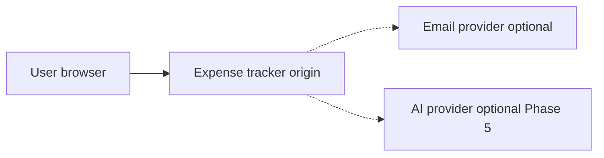
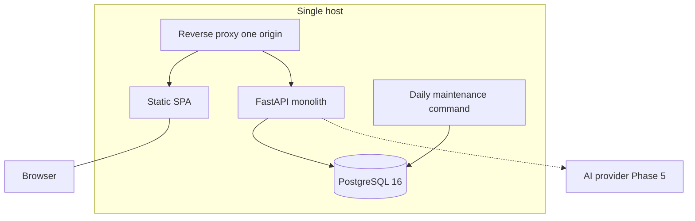
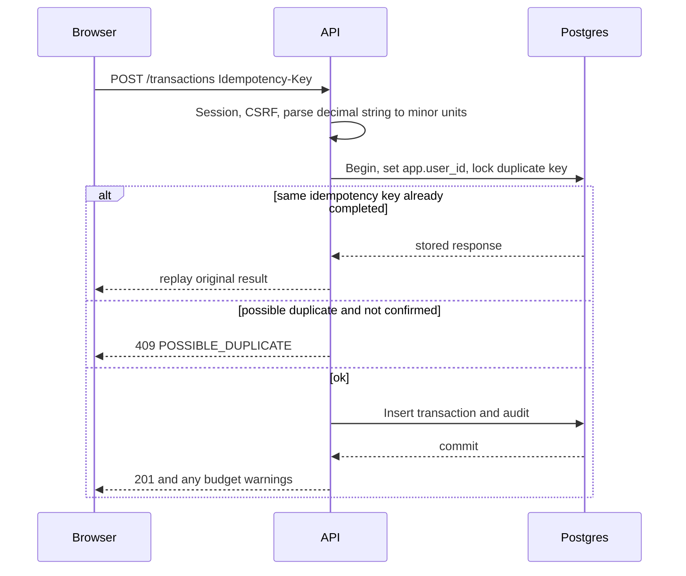
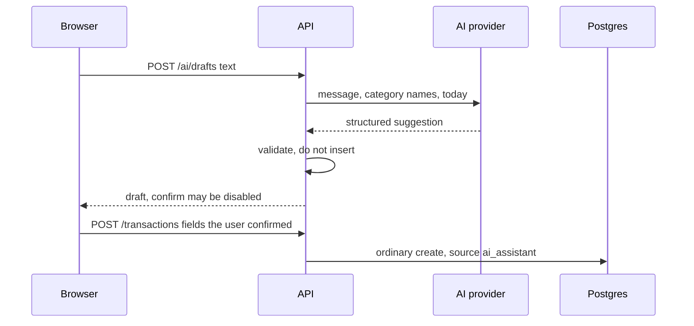

# High-Level Design

Status: **Proposed**
Date: 2026-11-19
Owners: DEV. Product Owner approval required before implementation.
Related: `LLD.md`, `DATABASE_SCHEMA.md`, `API_SPECIFICATION.md`, `ADR/`, `AC_TRACEABILITY.md`, `docs/discussions/001-mvp-discovery.md`

## 1. Purpose

A single-user personal ledger with strict correctness on money and dates, private to the account that created it. The system records income and expenses, categorises them, shows a month, enforces nothing about budgets except to warn, and exports CSV. A later phase adds natural-language drafts and read-only questions. This document describes the shape. It is not an implementation.

## 2. Quality bar that drives the shape

| Need | Architectural consequence |
|---|---|
| Totals match line items to the paisa | Integer minor units in the database and in aggregates. No binary floating point on the money path. |
| A transaction stays on the day the user picked | `date` column, not an instant. Timezone lives on the user and affects "today" only. |
| One person must not see another's ledger | Application filters plus Postgres row-level security, tested with two users. |
| A double-click or a retry must not double-charge the ledger | Idempotency keys stored per user. |
| Two tabs must not silently overwrite | Row `version`, 409 on mismatch. |
| A delete is recoverable for 30 days, and a purge actually removes data | Soft delete, then a daily command that deletes the row and its financial audit. |
| AI must not invent a transaction | No write tool. Confirm calls the same create path as the form. |
| The app works when AI is off | AI is a separate route group on the same process, not a service the dashboard calls. |
| One person operates this | One process, one database, one host. No microservices, no Redis. |

## 3. Context



The browser is untrusted. The email provider and the AI provider are outside the trust boundary and are optional. Everything else in v1 sits behind one origin the user logs into.

What crosses the boundary:

| Crossing | Data | Never included |
|---|---|---|
| Browser ↔ app | Account email, session cookie, transactions the user typed, aggregates | Other users' rows |
| App → email provider | Verification or reset token addressed to the user's email | Ledger rows |
| App → AI provider, Phase 5, only if enabled and disclosed | The sentence the user just typed, category names, today's date, and aggregate tool results | The stored ledger, historical notes, other users, credentials |

The typed sentence usually contains an amount. The disclosure has to say that. "We do not send the ledger" is accurate. "We never send an amount" would be false.

## 4. Containers

One host, three long-lived processes once Phase 3 exists, plus a daily command.



| Container | Responsibility | Not responsible for |
|---|---|---|
| Reverse proxy | TLS when the host is public, one origin, forward `/api` to the app and everything else to the static files | Business rules |
| SPA | Forms, Indian digit grouping, showing drafts, sending the idempotency key and the version | Deciding that a write is valid. It mirrors server errors. |
| API | Auth, validation, money parsing, SQL, audit, CSV, and later the AI provider call | Rendering HTML |
| PostgreSQL | Durability, constraints, row-level security, aggregates | Calling the network |
| Maintenance command | Purge, idempotency cleanup, account-deletion purge | Serving traffic |

The proxy technology (Caddy or nginx) is a reversible detail inside ADR-006. The constraint that matters is one origin, so the session cookie is not a cross-site problem.

There is no separate worker fleet. The maintenance command is the same codebase, invoked once a day by the host scheduler. It must not run inside every API process, so a future second replica cannot purge twice. With one replica, a compose service on a clock is enough.

## 5. Component view inside the API

```text
HTTP routers
  → services (transactions, categories, budgets, reports, export, auth, ai)
    → domain (pure: money, budget state, calendar windows, CSV escaping)
    → db (SQLAlchemy session, RLS context, repositories)
```

Domain code does not import the database. Services own transactions: a use case is one database transaction that writes the row and the audit row, or neither. Routers do not compute sums.

The AI module, when it exists, may call services that read. It may not call the function that inserts a transaction. The HTTP handler for "confirm" is the transaction router.

## 6. Main flows

### 6.1 Manual create



Budget warnings in that response are computed from the month's totals after the insert. Nothing is enqueued.

### 6.2 Edit conflict

The client sends the `version` it displayed. The update matches `id` and `version` and the RLS policy. Zero rows updated means either the resource is not visible (404 after a select that also sees nothing) or the version moved (409 with the current body). There is no merge.

### 6.3 Natural-language entry (Phase 5)



Cancel or closing the page has no server call that writes. A prompt in the text has no tool available that deletes or updates.

### 6.4 Question (Phase 5)

The model may call only the read tools in the LLD. Tools run under the caller's `app.user_id`. The response always includes the structured tool payload. Prose is attached only after a check that every number in the prose occurs in that payload.

## 7. Data model, in one page

Private tables carry `user_id`. The ones that matter:

- `users` — credentials, IANA timezone, home currency, AI flags, deletion request.
- `sessions`, `login_attempts`, `email_tokens` — auth. Session token stored only as a hash.
- `categories` — per user, income or expense, archive timestamp.
- `transactions` — minor units, currency, calendar date, category, optional payment method, note, source, version, `deleted_at`.
- `budgets` — effective-dated periods, overall or per category, minor units, version.
- `audit_events` — append-only for the application role while the subject lives. Purged with the subject.
- `idempotency_keys` — per user, 24-hour retention.

Details, constraints, and indexes are in `DATABASE_SCHEMA.md`.

## 8. Security architecture

| Threat | Control |
|---|---|
| Cross-user read or write by id | RLS using `current_setting('app.user_id')`, set with `set_config` locally on each transaction. Unset means no rows. 404 on a miss. Composite foreign keys so a category id from another user cannot be stored. |
| Stolen cookie via XSS | HttpOnly session cookie. Notes rendered as text. CSP planned at the proxy in Phase 3. |
| CSRF | `SameSite=Lax` plus a double-submit token required on every state-changing request and on CSV export. |
| Credential stuffing | Argon2id, generic errors, rolling window of 5 failures per account in 15 minutes, dummy verify when the account is missing. |
| Session theft after reset | Reset revokes all sessions. Login rotates the session id. |
| Replay of a create | Idempotency key bound to the user and the payload hash. |
| Lost update | Optimistic version. |
| Prompt injection | Tool list is code, not model text. No write tool exists. Backend re-validates any draft the user confirms. |
| CSV injection | Escape fields that start with `=`, `+`, `-`, `@`, tab, or carriage return. |
| Ledger in logs or Git | Log denylist. `.gitignore` covers `.env`, dumps, and csv. Review rule in the PR template. |
| Backup theft | Encrypted dumps. Key is not in the repo. Retention 7 days. |
| Privilege of the app role | Not a superuser, not the table owner, so RLS applies. Cannot `DELETE` transactions or audit rows directly. Purge goes through a `SECURITY DEFINER` function. |

Password policy: at least 10 characters, not in a bundled common-password list, at most 128 characters. Hashing parameters follow the OWASP Argon2id baseline (19 MiB memory, time cost 2, parallelism 1) unless the library's documented default is stricter at implementation time. Record the actual parameters in the Phase 3 PR.

Account deletion: password re-entry, sessions revoked immediately, login then returns `ACCOUNT_PENDING_DELETION`, rows removed by the daily command within 30 days. Undo during that window is not in the contract (the acceptance criteria say the account cannot log in). It can be added later without a schema change because `deletion_requested_at` is reversible in principle; it is not an endpoint now.

## 9. Availability, backups, performance

Target 99.5% is a product assumption for a personal app, not something this design can promise on an unknown host. The design promise is narrower:

- AI failure returns an error on AI routes only.
- The database is the durability boundary. One daily encrypted dump, 7-day retention, RPO 24 hours, RTO 4 hours, only credible after PO-Q4 names an operator and Phase 6 runs a restore.
- Dashboard and list targets (p95 under 1 second and under 500 milliseconds at 10k transactions) are design budgets: set-based aggregates, the indexes in the schema doc, no round trip per category. They become a measured gate on the real host, not a flaky CI rule. See discovery challenge C3.

## 10. Deployment

Proposed unit: Docker Compose. Images, once they exist: `postgres:16`, the API image, a static web image or the proxy serving built files, and a one-shot maintenance service with a daily clock.

Environments: `local` (console email, `Secure` cookie off), and one deployed environment if the Product Owner wants one. No staging tier until there is a reason.

Configuration is environment variables. Required later: database URL, session secret, and, only in Phase 5, the AI key and base URL. Missing AI configuration disables AI routes. It does not stop the process.

## 11. Observability

Structured JSON logs. Fields: timestamp, level, request id, route template, status, latency, and for AI calls the token count and latency. A denylist drops amount, note, email, password, cookie, authorization, and prompt. The audit table is the financial history; logs are not.

Health: `GET /api/health` returns `{"status":"ok"}` when the process can run a trivial query. It does not return versions, row counts, or configuration.

## 12. Evolution that should not require a rewrite

| Future request | What stays |
|---|---|
| Indian financial year | Same report query, different date preset |
| Another currency | Currency code is already stored. API stops rejecting non-INR. Aggregates already group by currency. Minor-unit exponent needs a table once any currency is not 2 digits. |
| Household sharing | New membership table and a change to the RLS predicate. Transaction rows already have an owner. This is still a large product change and is not "just a flag." |
| Second API replica | Move the daily command to a single external timer. Session store is already in Postgres, so replicas do not need sticky sessions. |
| CSV import | New write path that calls the same create service, plus a mapping and dedupe design. Not a new ledger. |

## 13. Out of scope for this design

Native apps, offline sync, microservices, Redis, server-side draft persistence, notification fan-out, stored percentage columns, multi-currency conversion, and any AI tool that inserts, updates, or deletes.

## 14. Traceability

`AC_TRACEABILITY.md` maps each acceptance criterion to the part of this design that is meant to satisfy it, and marks the rows that are still product-pending. Those rows are not silently marked done.
