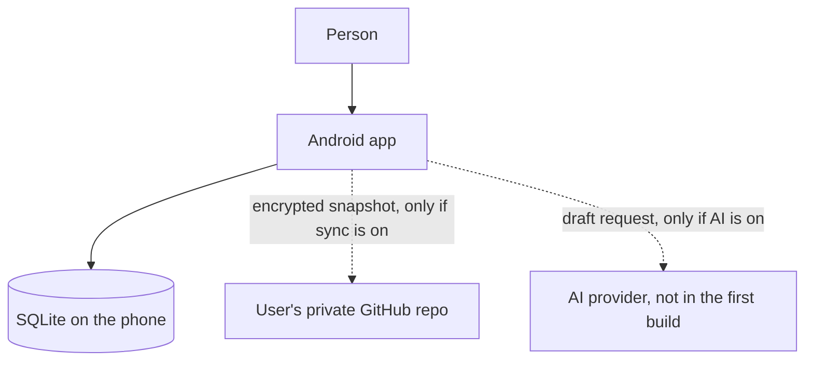
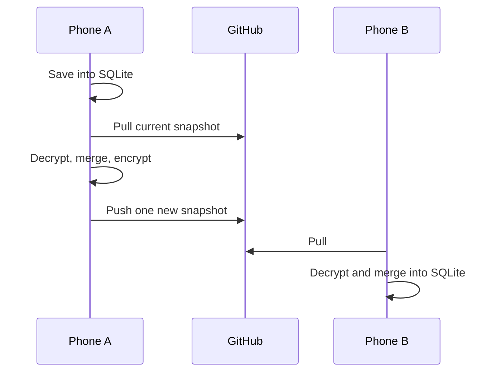

# High-Level Design

Status: **Accepted** for the product decisions in the 2026-11-19 addenda of `docs/discussions/001-mvp-discovery.md`. Phase 3 still waits for an explicit go-ahead. The snapshot file layout (ADR-014) is the remaining Proposed mechanism.
Date: 2026-11-19
Supersedes: the server-based HLD in the first draft on this branch. That draft is not the design to build.

## 1. What this is

An Expo / React Native app, TypeScript, installed on Android first. The same project can produce an iOS build later. The ledger lives in SQLite on the phone. A save finishes before any network call. GitHub is optional. If the user connects an account, another phone can sync through a **private repository they own**, carrying ciphertext. Many people can install the app. Their data is not shared, and we never hold it.

The Product Owner builds and tests through cloud agents only. He does not install Android Studio. Continuous tests run on GitHub Actions. Installable APKs are produced by EAS Build and downloaded from a link (ADR-018).

There is no household ledger, no hosted Postgres, and no account on a service of ours.

## 2. What did not change

- Paise are integers. Currency is a code. Nothing in the money path is a binary float.
- A transaction day is a calendar date. The default timezone is `Asia/Kolkata`. Changing timezone does not move old dates.
- Budgets warn from integer comparisons: `ok`, `approaching`, `at_limit`, `exceeded`.
- Two writers do not silently overwrite. On one phone that is a local revision check. Across phones it is a conflict screen.
- A double tap does not create two rows.
- The dashboard headline is **Net**: income minus spending. Spending is expenses minus refunds. Reports open on the calendar year and include an Indian financial-year preset, 1 April through 31 March, labeled FY YYYY-YY by the starting year.
- Past budget months are locked. The current month and future months can be edited.
- AI is out of the first build. The boundary stays: a later module may only draft, and a write still requires confirmation.

## 3. Containers

The solid arrow is the save path. The dotted arrows are optional and fail without taking the ledger with them.

| Piece | Holds | Must not hold |
|---|---|---|
| Phone SQLite | The ledger, the outbox, unresolved conflicts, local change history | A GitHub token in plaintext |
| Android Keystore | GitHub access and refresh tokens, SQLCipher key, cached data key after unlock | Nothing we ship to a server, because there is no server |
| GitHub repo | `manifest.json` (cipher parameters and wrapped key only) and `snapshot.enc` | Plaintext amounts, notes, category names, the passphrase, the token |
| AI provider, later | The sentence the user just typed, if they turn the feature on | The database file, the token, the key |

We do not appear in this picture as a runtime. The GitHub App registration is a developer account, not a data plane.

## 4. Save, sync, conflict

A tap on Save opens one SQLite transaction: write the row, write history, write an outbox record, commit. The screen updates from that commit. Sync, if it runs, is later.

Merge rules, in one paragraph. Entries created on different devices have different ids and both survive. An edit whose parent revision is the revision we already have is applied. An edit whose parent is not the revision we have, and which we have not already applied, is a conflict: the user sees both versions and the push does not proceed with a guess. A delete is a tombstone. A delete on one phone and an edit on the other is a conflict, not a silent delete and not a silent resurrection.

Git does not merge the encrypted file. If the remote moved between our pull and our push, we pull again and merge again. Details are in the sync protocol (`API_SPECIFICATION.md`) and the LLD.

## 5. Keys, in plain language

The snapshot is encrypted with a random key (the DEK). The passphrase wraps that key. A recovery code, shown once, also wraps it. The phone stores the unwrapped key in the keystore so the user is not asked on every save.

A second phone needs the GitHub account and the passphrase (or the recovery code). It does not need our help.

**If the passphrase and the recovery code are both gone, and no phone still has the key in its keystore, the snapshots on GitHub cannot be opened. That data is lost. Nobody can reset it, including us.** The setup screen has to say this before the user depends on the app.

## 6. Delete, restore, and what Git cannot forget

For 30 days, a delete is a tombstone in the live data. Restore brings the row back. Totals ignore tombstones. This works offline and across phones that have synced.

After 30 days the row leaves the live snapshot. Older Git commits can still contain it, encrypted with the current key, until the user runs **history compaction**. Compaction writes a brand-new first commit of only the current snapshot, under a new data key, and force-pushes the **data** branch. It does not touch the source-code repository. The user confirms it, because other phones will need the passphrase again. GitHub may still retain private copies we cannot delete. Deleting the whole repository is the stronger "erase me" action, and the same residual applies.

Do not describe compaction as optional polish. Without it, "deletion really deletes" is false. Do not run it silently.

## 7. GitHub, said honestly

This is the fragile part of the design.

GitHub is a place to put Git repositories. It is not a database with a contract for ledger sync. The design treats it as a dumb private blob store with a compare-and-swap on the file sha: one snapshot up, one snapshot down. That stays inside the published rate limits in a way that one HTTP call per transaction would not. It can still break.

What we are relying on, and what fails open (local data remains):

- The user's GitHub account exists and stays in good standing.
- The OAuth device flow and a contents-only GitHub App keep working.
- One content write per sync stays acceptable. We debounce sync and we back off on 403 and 429.
- The repo stays private. If it is public, sync stops.

What GitHub will always be able to see: that this account uses the app, when syncs happen, and roughly how large the blob is. Encryption does not hide size or timing. Commit messages are constant so they do not add a note or an amount.

A person with no GitHub account uses the app on one phone and exports CSV. That path is complete, not a degraded mode. Sync is the optional second phone and the optional backup. We do not invent a server if they skip GitHub.

## 8. Security boundary

| Threat | What we do |
|---|---|
| Another installer's data | We never store it. There is no shared database to forget a `WHERE` clause on. |
| Stolen phone, locked | SQLCipher key is in the keystore. |
| Stolen phone, unlocked | The ledger is open. This design does not pretend otherwise. |
| Stolen GitHub token | Contents of one repo: ciphertext, and the ability to delete that ciphertext. Not the user's other repositories, if the GitHub App permission is held to contents on that repo. |
| Stolen passphrase from a weak choice | Offline attack on the wrapped key. Argon2id makes it expensive. A short passphrase still loses. Minimum length 12, plus a common-password check. |
| Public repo by mistake | Refuse to sync. |
| Prompt injection, if AI is built | The model has no write tool. Confirm calls the same SQLite save as the form. |
| Logs | No amounts, notes, passphrase, recovery code, tokens, or snapshot plaintext. |
| Lockout | Accepted. A wrong passphrase delays the next try. It never wipes the database and it never locks forever. |

## 9. Accepted product rules

| Rule | Behaviour |
|---|---|
| Refunds | A refund is not income. It subtracts from the expense category it names. Amounts stay positive; the type carries the direction. Net is income minus expenses plus refunds. |
| Card bills and EMIs | The app warns, and does not block. Logging the swipe and the later card-bill payment counts twice. An EMI is the installment; logging the full price as well counts twice. |
| CSV | UTF-8 with a BOM so Excel opens it. |
| Repeat | Copies amount, type, category, payment method, and note into a **new** id dated today. Not a scheduler. |
| No hard lockout | Backoff only. |
| Headline | The word on the dashboard is **Net**. |
| Year | Calendar year by default. Indian FY preset included. |
| Past budgets | Locked. Current and future months stay editable. |

## 10. AI

Out of the first build. The module boundary in ADR-005 stays so a later phase does not grow a write tool. No model id is pinned. No provider key is required to build or run the app.

## 11. What this design will not do

Household sharing. A server-side copy of the ledger. Silent overwrite. Git merge of ciphertext. One API call per entry. A forgot-passphrase link. A promise that GitHub's internal backups forget on our timetable. An iOS binary in the first release. A requirement that the Product Owner install Android Studio.

## 12. Where the detail lives

| Topic | Document |
|---|---|
| Tables | `DATABASE_SCHEMA.md` |
| Pull, merge, push, HTTP to GitHub | `API_SPECIFICATION.md` |
| Merge algorithm, budgets, refunds | `LLD.md` |
| Why these choices | `ADR/ADR-012` through `ADR-018` |
| Cloud test and APK | `ADR-018`, `docs/development/DEVELOPMENT_GUIDE.md` |
| Old server decisions | ADR-001 through ADR-004, ADR-006, ADR-009, ADR-011, marked Superseded |
